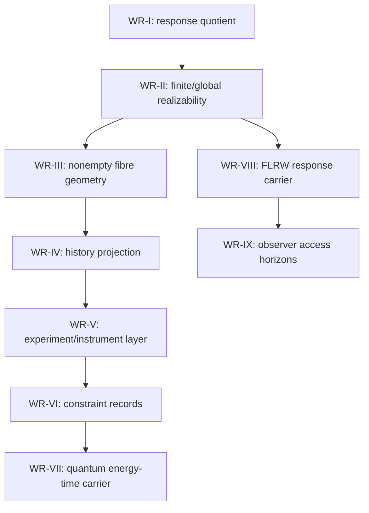

# WREH first-cycle inter-paper audit and monograph framework

Status: preparatory audit framework, not a frozen scientific article.  
Scope: WR-I--WR-IX, first technical cycle closed on 10 October 2026.  
Repository base inspected: `main` at `26e0c2b7ed0ec48dd36e32da9f7550ea74021ec8`.  
Boundary: this document does not modify deposited scientific files, does not assert external peer review, and does not prove new theorems by compilation.

## 1. Source discipline

The monograph may use the nine deposited preprints as frozen sources, but must cite them by version and DOI. English and Russian manifestations are manifestations of the same version-local article, not separate scientific versions.

| Article | Frozen version | DOI | Primary repository source for this framework | Independent external peer review |
|---|---:|---|---|---|
| WR-I | v0.3 | [10.5281/zenodo.23210258](https://doi.org/10.5281/zenodo.23210258) | `papers/WR-I/README.md`; no `THEOREM_MAP.md` exists on `main` | Not established |
| WR-II | v0.5 | [10.5281/zenodo.23224154](https://doi.org/10.5281/zenodo.23224154) | `papers/WR-II/THEOREM_MAP.md` | Not established |
| WR-III | v0.6 | [10.5281/zenodo.23228682](https://doi.org/10.5281/zenodo.23228682) | `papers/WR-III/THEOREM_MAP.md` | Not established |
| WR-IV | v0.6 | [10.5281/zenodo.23248138](https://doi.org/10.5281/zenodo.23248138) | `papers/WR-IV/THEOREM_MAP.md` | Not established |
| WR-V | v0.3 | [10.5281/zenodo.23251956](https://doi.org/10.5281/zenodo.23251956) | `papers/WR-V/THEOREM_MAP.md` | Not established |
| WR-VI | v0.2 | [10.5281/zenodo.23254619](https://doi.org/10.5281/zenodo.23254619) | `papers/WR-VI/THEOREM_MAP.md` | Not established |
| WR-VII | v0.2 | [10.5281/zenodo.23264253](https://doi.org/10.5281/zenodo.23264253) | `papers/WR-VII/THEOREM_MAP.md` | Not established |
| WR-VIII | v0.2 | [10.5281/zenodo.23266980](https://doi.org/10.5281/zenodo.23266980) | `papers/WR-VIII/THEOREM_MAP.md` | Not established |
| WR-IX | v0.2 | [10.5281/zenodo.23272637](https://doi.org/10.5281/zenodo.23272637) | `papers/WR-IX/THEOREM_MAP.md` | Not established |

Canonical publication registry: `registry/FIRST_CYCLE_PUBLICATIONS.json`. First-cycle closure record: `docs/FIRST-CYCLE/README.md`. Closure audit: `docs/FIRST-CYCLE/CLOSURE_AUDIT.md`.

## 2. Programme-level claim boundary

The first cycle establishes a response-first mathematical programme with model-relative fibres, compatibility classes, hard constraints, resource records and observer-access horizons. It does not establish:

- independent external scientific peer review;
- physical existence of any compatible complete world;
- uniqueness of the actual Universe;
- a new gravity theory;
- universal epistemic horizons for all possible observers;
- equivalence between mathematical admissibility, physical realizability and empirical confirmation;
- a monograph as an already approved next-stage scientific work.

The monograph can be a synthesis only after it keeps theorem hypotheses, carrier types and claim ceilings visible. Compilation alone must not promote an open obligation into a theorem.

## 3. Unified object and notation map

| Layer | Preferred monograph notation | Owned by | Meaning | Transfer rule |
|---|---|---|---|---|
| World class | `mathcal W` | WR-I | Declared admissible global realizations | Model-relative; not physical reality itself |
| Protocol family | `mathcal P`, `mathcal A subset mathcal P` | WR-I | Declared admissible observation protocols | Refinement is logical/protocol refinement, not time by default |
| Response maps | `R_P: mathcal W -> mathcal Y_P` | WR-I | Protocol response of a world | Response equality is operational/model-relative |
| Response quotient | `mathcal Q_A = mathcal W / sim_A` | WR-I | Classes indistinguishable by `A` | Not ontological identity |
| Finite consistency | `C_fin`, finite images `E_A` | WR-II | Profiles whose every finite restriction is realizable | Does not imply global realization without compactness/attainment hypotheses |
| Global defect | `D_fin` or explicit defect set | WR-II | Finite-consistent but globally unrealized profile class | Requires infinite or context-restricted structure; not a physical impossibility by itself |
| Response fibre | `Phi_A(e)=R_A^{-1}(e)` | WR-III | Nonempty inverse response set | Set-theoretic fibre unless bundle/triviality assumptions are declared |
| Fibre diameter | `D_A(e)` | WR-III | Metric spread of compatible realizations | Metric/model dependent; not universal information measure |
| Structural wall | local-triviality failure | WR-III | Change in fibre structure for a response map | Not automatically a physical wall, phase transition or spacetime boundary |
| History-compatible set | `mathfrak C(D)` | WR-IV | Worlds compatible with a data profile under fixed carrier/cut/projection | A historical projection, not time reversal or past rewriting |
| Past image | `mathfrak H_-(D)=pi_-(mathfrak C(D))` | WR-IV | Compatible past histories/images | Image sets, probability laws and supports must remain separated |
| Instrument | `I_e(r,s | x)` | WR-V | Finite outcome-plus-successor model | Outcome data do not determine successor law without probes/constraints |
| Completion fibre | calibrated probe fibre | WR-V | Successor laws compatible with calibrated probes | Different carrier from full world/history fibres |
| Constraint record | observations, structure, hard bounds, uncertainty | WR-VI | Declared physical/mathematical restrictions | Physical justification is an independent obligation |
| Quantum resource class | `C(E,tau,J)` | WR-VII | Unit-bearing Hamiltonian completion class | Spectral diameter/time carrier; not WR-VI activity and not cosmological energy |
| Cosmological fibre | compatible `(kappa,H)` or FLRW lifts | WR-VIII | Kinematic distance-rate cosmological compatibility class | Exact derivatives/calibration/branch assumptions required |
| Observer access record | finite complete protocols with time/energy certificates | WR-IX | What an internal observer can distinguish under declared resources | Stronger than compatibility; requires accessibility protocol and costs |

Recommended monograph convention: every theorem statement should begin with a carrier tag such as `[WR-II inverse-limit]`, `[WR-V finite instrument]`, `[WR-VII quantum resource]`, `[WR-VIII FLRW kinematic]`, or `[WR-IX observer-access]`.

## 4. Dependency spine

The diagram is a documentation spine, not a theorem. Some later papers reuse earlier language without inheriting all earlier hypotheses. In particular, WR-VII and WR-VIII are parallel specialized carriers after the general response/fibre discipline; WR-IX adds access certificates on top of a declared cosmological/topological benchmark.

## 5. Theorem and result ownership map

| Owner | Results safe to synthesize | Main assumptions to preserve | Do not transfer as |
|---|---|---|---|
| WR-I | Exact response equivalence, quotient, identifiable quantities, refinement, finite-resolution separation on compact admissible domains | Declared `mathcal W`, `mathcal P`, response maps, compactness where used | Ontological identity or physical existence |
| WR-II | Finite inverse systems, finite/global trichotomy, compact and closed-image globalization, residual identities, explicit defects/nonattainment | Infinite protocol/context structure for defects; compactness/closedness/attainment for positive results | Proof that every finitely consistent physical profile is realized |
| WR-III | Refinement inclusion, fibre-diameter monotonicity, rigidity gain, conditional rank, local triviality/wall examples, localization ladder | Nonempty fibres; declared metric/topology/smoothness; properness/open/closed map hypotheses as stated | Universal spacetime geometry or physical walls |
| WR-IV | History projections, nested hard constraints, past/observable rigidity, wall transfer/erasure, classical Gaussian/Brownian/RTS benchmarks | Fixed carrier, temporal cut, projection, law/image distinction | Past rewriting, retrocausality, strict set contraction from covariance alone |
| WR-V | Finite instruments, product-of-simplex completion, rank/cone criteria, identifiable functionals, finite adaptive positivity | Finite carriers, calibrated probes, positive likelihood conditions, exact response matrices | Physical branching/collapse or quantum measurement theory |
| WR-VI | Constraint record, detailed-balance benchmark, exact interval, activity threshold, irreducibility/tolerance/cap-uncertainty audits | Finite reversible model, externally supplied cap, exact intervals | Energy, entropy, rate, or universal physical bound |
| WR-VII | Unit-bearing quantum speed-limit style inequality, sharp qubit frontier, generator fibre, tomography with added probes, interval/sample certificates | Closed pure finite-dimensional unitary carrier, spectral diameter in joules, time in seconds, fixed projector/preparation | Cosmological energy budget, gravity bound or unique Hamiltonian/world |
| WR-VIII | FLRW distance-rate inverse family, scale ambiguity, finite inverse benchmark, interval intersection, local torus patch equivalence, future bumps | Exact calibrated `D in C^2`, `D(0)=0`, `D'>0`, positive rate intervals, closed local path patch, extra `C^infty` baseline for bumps | Full Universe identification, global topology access, matter-law realization |
| WR-IX | Access gap, finite witness criteria, adaptive equality of finite transcripts, finite winding return iff `L<S_infty`, detector time-energy frontier, tail convergence examples, robust/nonuniform access | Declared observer protocols, common finite resources, positive future scale factor, calibrated lattice axis, ideal null tagged ray/detector | Universal observer horizon, apparatus feasibility, automatic result of WR-VIII topology |

## 6. Known mathematical results vs WREH-owned contributions

| Category | Examples in the cycle | Treatment in monograph |
|---|---|---|
| Classical/standard mathematics | inverse limits, compactness, closed-image criteria, Ehresmann local triviality, Gaussian conditioning, Brownian bridge, RTS smoothing, finite linear algebra, reversible Markov chains, Pauli/qubit calculations, FLRW distance identities, CBL curvature identity, null propagation/redshift | Cite as known tools; do not present as WREH novelty |
| WREH architectural contribution | response-defined world spaces; strict separation of response equivalence, realizability, fibre geometry, history projection, instrument completion, constraint record, quantum resource certificate, cosmological response fibre and observer access | Present as programme synthesis, with exact owner article and assumptions |
| WREH worked benchmarks | finite/global defect examples, localization ladder, finite instruments, three-state constraint interval, qubit resource frontier, FLRW inverse class, torus winding access benchmark | Present as model-relative benchmarks, not universal physical laws |
| Open/next-stage science | empirical inverse problem, matter/dynamics carriers, real apparatus costs, external peer review, priority comparison, physically realizable cosmological futures | Keep in agenda chapters or appendices; do not fold into theorem text |

## 7. Cross-paper audit findings

| ID | Finding | Severity | Required monograph control |
|---|---|---:|---|
| A1 | WR-I lacks a `THEOREM_MAP.md` on `main`; its monograph map must be reconstructed from the v0.3 source/README and checked manually against the deposited PDF/source. | Medium | Add a WR-I theorem map before final monograph drafting, or mark reconstruction basis explicitly. |
| A2 | `D` is overloaded: distance profile in WR-VIII, fibre diameter in WR-III, spectral diameter/resource `D` in WR-VII contexts, data profile in WR-IV prose. | High | Use chapter-local notation or prefixes: `D_cos(z)`, `diam_A(e)`, `Delta_H(t)`, `Data`. |
| A3 | `H` is overloaded: Hubble rate in WR-VIII/IX, Hamiltonian in WR-VII, history notation in WR-IV. | High | Reserve `Hubble(z)` or `mathcal H(z)` for cosmology, `K(t)` or `H_op(t)` for Hamiltonians, `Hist_-` for histories. |
| A4 | WR-III structural walls and WR-VIII branch endpoints/topological patch boundaries are different notions. | High | Never call a cosmological branch endpoint a structural wall unless local-triviality hypotheses are proved. |
| A5 | WR-VI activity cap and WR-VII spectral energy cap are not the same physical quantity. | High | Keep dimensionless activity, joule spectral diameter and cosmological photon launch energy in separate units tables. |
| A6 | WR-VIII Theorem 7.1 gives local metric preservation in a bounded patch for copied fields/paths; it does not give observer-accessible global topology. | Critical | Route any global-return or access claim through WR-IX-style protocol, cost and finite-return criteria. |
| A7 | WR-IX Theorem 4.1 adds `L<S_infty` as finite winding-return criterion; this is not contained in WR-VIII local torus equivalence. | Critical | State as an additional observer-access theorem under its own assumptions. |
| A8 | WR-IX photon launch/detector energy frontier is not WR-VII spectral-diameter quantum frontier. | Critical | Separate the null-ray/detector model from Hamiltonian spectral diameter; no numerical substitution without a bridge theorem. |
| A9 | Compact future bumps in WR-VIII do not by themselves change conformal-tail convergence; WR-IX uses noncompact smooth tail constructions for opposite finite/infinite tails. | High | Tail chapters must separate compact bump nonuniqueness from conformal-tail horizon criteria. |
| A10 | Covariance contraction in WR-IV does not imply strict historical set shrinkage; finite earlier prefixes may remain compatible. | High | Keep image-set, law, support and variance statements separate. |
| A11 | WR-V outcome likelihood, successor transition and full world labels are distinct; monograph prose must not collapse them into one selection event. | High | Use a three-column type table for outcome/state/world in the experiment chapter. |
| A12 | Several results are elementary/classical; claiming broad priority would overstate the cycle. | Medium | Include provenance footnotes or source-map appendix. |

## 8. Required bridge lemmas before any unified theorem

The monograph may propose bridges, but should mark them as open unless independently proved.

| Proposed bridge | Current status | Needed before theorem status |
|---|---|---|
| Response quotient to physical realization | Not established in first cycle | Declared physical carrier, empirical calibration and existence theorem |
| Finite/global defect to empirical falsification | Model-relative only | Measurement model, noise, covariance, model-comparison criterion |
| WR-III wall to physical/cosmological boundary | Not established | Smooth response map, properness/local-triviality failure, physical interpretation bridge |
| WR-IV history projection to physical past | Interpretive only | Dynamics, temporal semantics and observation protocol connecting projection to physical history |
| WR-V instrument completion to quantum measurement | Not established | Hilbert-space representation, POVM/instrument realization and operational equivalence proof |
| WR-VI activity cap to WR-VII energy | Not established | Unit conversion or physical model deriving both from one conserved/resource quantity |
| WR-VIII local topology lift to WR-IX finite observer access | Partially linked only by later benchmark | Complete finite protocol, path/control budget, causal reach, detector model and `L<S_infty` proof |
| WR-VII spectral cap to WR-IX photon launch energy | Not established | A joint carrier with Hamiltonian control and null-ray detection resource accounting |
| Kinematic FLRW compatibility to matter-realized cosmology | Open | Matter law, stability, perturbations, units, observational likelihood |

## 9. Proposed monograph structure: English

Working title: *World Realizability and Epistemic Horizons: Response, Realization and Observer Access*.

1. Programme contract and source discipline
   - first-cycle publication map;
   - claim firewalls;
   - known mathematics vs WREH contributions.
2. Response-defined world spaces
   - WR-I quotient language;
   - identifiability and refinement;
   - finite resolution and compactness boundary.
3. Finite consistency and global realizability
   - WR-II inverse-limit discipline;
   - finite/global defects;
   - residual and nonattainment examples.
4. Geometry of compatible fibres
   - WR-III fibre correspondence;
   - rigidity, diameter, conditional rank;
   - structural walls and localization benchmarks.
5. Histories and retrospective compatibility
   - WR-IV world/past projections;
   - classical smoothing benchmarks;
   - image/law/support/covariance separation.
6. Experiments, instruments and successor ambiguity
   - WR-V finite instrument contract;
   - outcome vs successor vs world;
   - rank, cone and probe completion criteria.
7. Constraint records and admissibility bounds
   - WR-VI hard bounds, uncertainty and relaxation;
   - detailed-balance benchmark;
   - robust uniqueness and cap uncertainty.
8. Quantum energy-time response frontiers
   - WR-VII Hamiltonian resource carrier;
   - speed-limit inequality, qubit frontier and generator ambiguity;
   - statistical/resource certificates.
9. Cosmological response fibres
   - WR-VIII FLRW distance-rate carrier;
   - calibration/scale ambiguity;
   - local topology lifts and future kinematic nonuniqueness.
10. Epistemic horizons and observer access
    - WR-IX access records;
    - finite witness and adaptive transcripts;
    - winding return, detector frontier and tail examples.
11. Synthesis: what survives unification
    - unified dependency map;
    - valid transfers;
    - forbidden transfers;
    - notation normalization.
12. Open second-cycle obligations
    - external review;
    - empirical inverse problems;
    - matter/dynamics carriers;
    - physically realizable observer protocols.

Appendices: DOI registry; theorem crosswalk; notation glossary; provenance/source-map index; bilingual terminology table; reproducibility checklist.

## 10. Предлагаемая структура монографии: русский язык

Рабочее название: *Реализуемость миров и эпистемические горизонты: отклик, реализация и доступ наблюдателя*.

1. Договор программы и дисциплина источников
   - карта публикаций первого цикла;
   - границы утверждений;
   - известная математика и собственный вклад WREH.
2. Пространства миров, заданные откликом
   - язык факторизации WR-I;
   - идентифицируемость и уточнение протоколов;
   - конечное разрешение и роль компактности.
3. Конечная согласованность и глобальная реализуемость
   - дисциплина обратных пределов WR-II;
   - конечные/глобальные дефекты;
   - остаточные расстояния и не-достижение.
4. Геометрия совместимых слоёв
   - соответствие слоёв WR-III;
   - жёсткость, диаметр и условный ранг;
   - структурные стены и навигационные модели.
5. Истории и ретроспективная совместимость
   - проекции мира и прошлого в WR-IV;
   - классические модели сглаживания;
   - различие образа, закона, носителя и ковариации.
6. Эксперименты, инструменты и неоднозначность преемника
   - конечный инструмент WR-V;
   - исход, преемник и полный мир как разные типы;
   - ранговые, конусные и зондовые критерии.
7. Записи ограничений и границы допустимости
   - жёсткие ограничения, неопределённость и релаксация WR-VI;
   - модель детального баланса;
   - робастная единственность и неизвестный предел.
8. Квантовые энерго-временные фронтиры отклика
   - гамильтонов носитель WR-VII;
   - неравенство скорости, кубитный фронтир и неоднозначность генератора;
   - статистические и ресурсные сертификаты.
9. Космологические слои отклика
   - FLRW-носитель расстояния и темпа WR-VIII;
   - калибровка и масштабная неоднозначность;
   - локальные топологические продолжения и кинематические будущие.
10. Эпистемические горизонты и доступ наблюдателя
    - записи доступа WR-IX;
    - конечные свидетели и адаптивные протоколы;
    - критерий возвращения, детекторный фронтир и хвосты будущего.
11. Синтез: что действительно объединяется
    - единая карта зависимостей;
    - допустимые переносы;
    - запрещённые переносы;
    - нормализация обозначений.
12. Открытые обязательства второго этапа
    - внешняя экспертиза;
    - эмпирические обратные задачи;
    - носители материи и динамики;
    - физически реализуемые протоколы наблюдателя.

Приложения: реестр DOI; перекрёстная карта теорем; глоссарий обозначений; индекс источников и происхождения результатов; двуязычная терминология; чек-лист воспроизводимости.

## 11. Bilingual terminology table

| English | Russian | Use note |
|---|---|---|
| response | отклик | Prefer over observation when referring to `R_P(W)` |
| admissible global realization | допустимая глобальная реализация | Model-relative object, not the actual world |
| response equivalence | эквивалентность по отклику | Operational equivalence, not ontology |
| response-defined world space | пространство миров, заданное откликом | Quotient by declared protocols |
| finite consistency | конечная согласованность | WR-II finite restrictions |
| global realizability | глобальная реализуемость | Realization inside declared `mathcal W` |
| fibre | слой | Set-theoretic preimage unless stronger structure is proved |
| rigidity | жёсткость | Singleton/small-diameter fibre property |
| structural wall | структурная стена | Local-triviality/bifurcation notion, not physical wall |
| history projection | проекция истории | Declared projection/cut, not past rewriting |
| instrument | инструмент | Finite outcome-successor model |
| constraint record | запись ограничений | Observations/structure/bounds/uncertainty separated |
| spectral diameter | спектральный диаметр | WR-VII Hamiltonian resource in joules |
| cosmological fibre | космологический слой | WR-VIII FLRW compatibility class |
| observer access | доступ наблюдателя | WR-IX protocols/resources/certificates |
| epistemic horizon | эпистемический горизонт | Model- and protocol-relative limit |

## 12. Verification checklist for monograph drafting

Before any monograph chapter is marked publication-ready:

- confirm every theorem statement against its frozen DOI version and repository source;
- add a WR-I theorem map or explicitly cite the exact v0.3 source sections used;
- normalize overloaded symbols chapter by chapter;
- tag every result as `known/classical`, `WREH theorem`, `worked benchmark`, `interpretation`, or `open obligation`;
- preserve the assumption block of each theorem in the chapter body, not only in footnotes;
- check every cross-paper transfer against Section 8 of this document;
- cite DOI and version on first use of each article;
- ensure English and Russian versions share theorem numbering and claim ceilings;
- do not cite automated checks as independent external peer review;
- keep empirical, physical-realism and apparatus-feasibility claims in open-obligation chapters unless independently proved.

## 13. Immediate next edits recommended

1. Create `papers/WR-I/THEOREM_MAP.md` for parity with WR-II--IX, derived from frozen v0.3 and marked as post-publication map only.
2. Add a machine-readable monograph crosswalk, for example `docs/MONOGRAPHY/theorem_crosswalk.json`, after the WR-I map exists.
3. Add `docs/MONOGRAPHY/NOTATION.md` with the normalized notation table and banned overloads.
4. Only after those controls exist, draft bilingual Chapter 1 as a source-disciplined synthesis rather than as a new WR-X-style paper.

## 14. Bottom line

The nine-paper cycle can support a monograph, but the monograph must be a disciplined synthesis, not an implicit tenth theorem. Its strongest safe thesis is:

> Observational responses define model-relative equivalence classes, fibres, histories, constraints and access limits; under declared hypotheses these objects have exact mathematical structure, but compatibility, physical realizability, empirical confirmation and observer accessibility remain distinct levels.

Russian formulation:

> Отклики наблюдения задают модельно-относительные классы эквивалентности, слои, истории, ограничения и пределы доступа; при явно заданных предпосылках эти объекты имеют точную математическую структуру, но совместимость, физическая реализуемость, эмпирическое подтверждение и доступность наблюдателю остаются разными уровнями.
